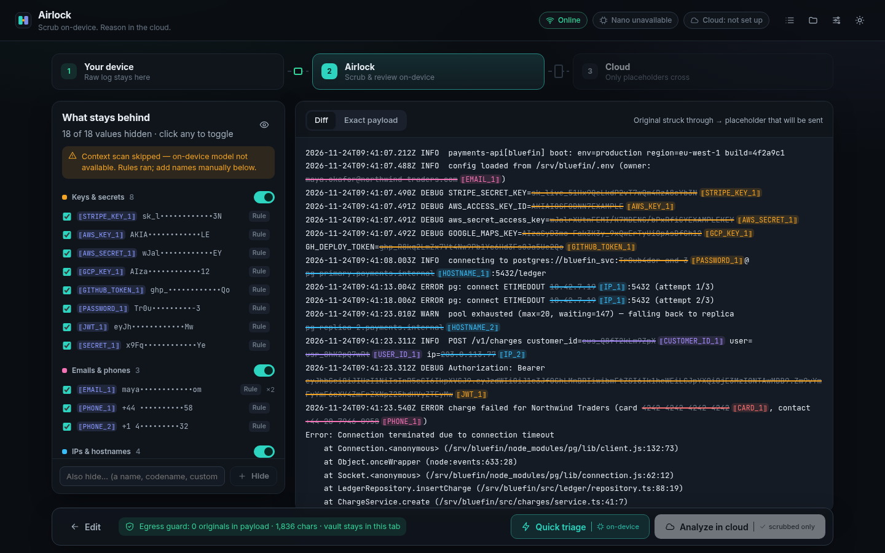
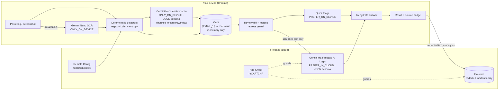

# Airlock

**Scrub on-device. Reason in the cloud.**

Airlock is an incident-triage tool for developers who can't paste production logs into an AI chat. You paste a log, stack trace or config (or drop a screenshot of an error). Airlock hides every secret and personal value **on your machine**: deterministic detectors first, then Gemini Nano running locally through Firebase AI Logic. You review exactly what will leave. Cloud Gemini then finds the root cause from the placeholder-only version, and Airlock puts the real values back into the answer, again only on your machine.

> Built for the **#BuildHybridAI** hackathon (Firebase AI Logic hybrid inference). Every line in this repo was written during the hackathon, starting 24 Nov 2026.

- **Live demo:** https://airlock-hybrid-ff7ef0.web.app
- **Video:** *(link after recording)*
- **Platforms:** Web app (Chrome desktop) and a Chrome extension (MV3 side panel) built from the same code



---

## Who it's for

On-call engineers, SREs and support engineers who work with logs full of API keys, customer emails, internal hostnames and card numbers. Their company policy (or common sense) says *"don't paste that into an AI"*. So they either skip AI help during incidents or redact by hand, which is slow and error-prone.

## What it does

| Step | Where it runs | What happens |
|---|---|---|
| 1. **Paste** | your device | Logs, stack traces, configs, or a PNG/JPEG screenshot of an error. One click loads a realistic "messy log" with fake secrets. |
| 2. **Scrub** | your device | 25+ deterministic detectors (AWS/GCP/Stripe/GitHub/Slack keys, JWTs, PEM private keys, passwords in connection strings, Sentry DSNs, emails, phones, IPv4/IPv6, internal hostnames, Luhn-valid cards, customer/user IDs, Shannon-entropy secrets). Then **Gemini Nano** (`ONLY_ON_DEVICE`, JSON-schema output) finds what regexes can't: people's names, customer names, internal codenames. Each value becomes a reversible placeholder such as `⟦EMAIL_1⟧` or `⟦AWS_KEY_1⟧`. The same value always gets the same placeholder, so the model can still tell that two lines mention the same customer. |
| 3. **Review** | your device | A side-by-side diff (original struck through → placeholder) and the *exact* payload, byte for byte. Toggle any item or whole category on or off, or add your own terms. An **egress guard** shows "0 originals in payload" and blocks sending if that ever stops being true. |
| 4. **Analyze** | cloud | Only the scrubbed text goes to cloud Gemini (`PREFER_IN_CLOUD`), which returns structured JSON: summary, likely cause, severity, confidence, evidence lines, fix steps and follow-ups. |
| 5. **Rehydrate** | your device | Placeholders in the answer are swapped back to real values (highlighted in green) from an in-memory vault. Flip a switch to see exactly what the model saw. |
| ⚡ **Quick triage** | device first | A one-line diagnosis from Gemini Nano (`PREFER_ON_DEVICE`) that also works offline. |

Every result carries a **source badge** read from the SDK's `response.inferenceSource` (`on_device` / `in_cloud`), not guessed. The **privacy ledger** lists every model call: the mode Airlock asked for, where it actually ran, its latency, and how many scrubbed characters went to the cloud.

## How hybrid inference is used (and why)

All inference goes through Firebase AI Logic (`firebase/ai`). Each feature has its own `GenerativeModel`, one per `InferenceMode`, chosen for a privacy reason:

| Feature | `InferenceMode` | Why this mode |
|---|---|---|
| Context scrub (names, customers, codenames) | **`ONLY_ON_DEVICE`** | Its input is the *raw* log. It must never fall back to the cloud, so if Nano is missing Airlock skips the step and says so. |
| Screenshot → text | **`ONLY_ON_DEVICE`** | Screenshots can't be regex-scrubbed. Nano transcribes them locally (text + image input), and the text then goes through the normal scrubber. Images are never uploaded. |
| Root-cause analysis | **`PREFER_IN_CLOUD`** | Deep reasoning over long logs needs the large cloud model. Its input is already scrubbed and checked by the egress guard. |
| Quick triage | **`PREFER_ON_DEVICE`** | Fast, free, and works offline. Its input is scrubbed, so a cloud fallback is also safe. |

Implementation details worth a look:

- **Structured output on both paths.** One JSON Schema per task goes to `onDeviceParams.promptOptions.responseConstraint` (Chrome Prompt API) and to `inCloudParams.generationConfig.responseJsonSchema` (cloud). Prompts are self-contained because the on-device path does not use `systemInstruction`. See [src/firebase/ai.ts](src/firebase/ai.ts) and [src/lib/prompts.ts](src/lib/prompts.ts).
- **Context window.** Airlock reads Nano's `contextWindow` (falling back to `inputQuota`, then 9,216 tokens), splits long logs on line boundaries into chunks that leave room for the prompt and answer, and scans each chunk ([src/lib/chunk.ts](src/lib/chunk.ts)). Quick triage instead sends a focused excerpt: lines around errors plus the tail.
- **Model download.** `initializeDeviceModel()` runs from a button click (a user gesture is required) and shows progress in the *On-device model* panel.
- **Trust, but verify.** If an `ONLY_ON_DEVICE` call ever reports `inferenceSource !== 'on_device'`, the result is thrown away.
- **SDK pitfall we guard against.** With `firebase@13.4.0`, if the browser has **no `LanguageModel` global at all** (Firefox, Safari, older Chrome), `getGenerativeModel` builds no Chrome adapter and an `ONLY_ON_DEVICE` request is **sent to the cloud** with `inferenceSource: 'in_cloud'`. [scripts/e2e-mocked.mjs](scripts/e2e-mocked.mjs) reproduces this. For a privacy tool that would be a leak, so Airlock refuses every `ONLY_ON_DEVICE` call unless `LanguageModel` exists ([src/firebase/ai.ts](src/firebase/ai.ts)).

### Other Firebase pieces

- **App Check is required.** The web app uses the reCAPTCHA Enterprise (or v3) provider. The debug-provider path is used only by `npm run dev`, with the token read from `.env.local`; it is compiled out of production builds (checked by building with a dummy token and grepping `dist/`). Cloud buttons stay disabled until App Check is set up.
- **Auth:** anonymous sign-in on first save, with optional Google sign-in (an anonymous account is upgraded with `linkWithPopup`).
- **Firestore** stores **only** redacted text plus the placeholder-form analysis, under `users/{uid}/incidents`. Before every write the client checks that no vault value appears anywhere in the document. [firestore.rules](firestore.rules) only accept the exact field set and are owner-only.
- **Remote Config** holds the redaction policy: per-category toggles, the Nano context scan, the entropy threshold, and allow-listed domains ([remoteconfig.template.json](remoteconfig.template.json)). A security team can tighten the policy for everyone without shipping a release. Users can loosen it for their own session only.
- **The vault** (placeholder → real value) lives only in the React state of the current tab. It is never written to Firestore, localStorage or any request.

## Architecture



## Setup

### 1. Chrome with Gemini Nano (for the on-device features)

1. Chrome desktop **139+** (Windows 10/11, macOS 13+, Linux, or ChromeOS on a Chromebook Plus).
2. `chrome://flags/#prompt-api-for-gemini-nano-multimodal-input` → **Enabled**
3. `chrome://flags/#optimization-guide-on-device-model` → **Enabled BypassPerfRequirement**
4. At least **22 GB free disk** on the volume that holds your Chrome profile. Relaunch Chrome.
5. In Airlock, click the **Nano** status pill → **Download Gemini Nano**. You can also check `chrome://on-device-internals`.

Without Nano, Airlock still works. Deterministic scrubbing runs, the context scan and screenshot OCR are skipped with a clear notice, and Quick triage falls back to the cloud on scrubbed text.

### 2. Firebase

Follow [OWNER_STEPS.md](OWNER_STEPS.md): create the project, enable AI Logic (Gemini Developer API, no billing needed), Firestore, Anonymous and Google Auth, App Check with reCAPTCHA, and Remote Config. Then copy `.env.example` → `.env.local` and fill it in.

### 3. Run locally

```bash
npm install
npm run dev          # http://localhost:5173
npm test             # vitest: detectors, placeholders, rehydration, chunking, policy
npm run build        # type-check + production build to dist/
npm run build:ext    # Chrome extension to dist-ext/ (load unpacked in chrome://extensions)
```

### Chrome extension

`npm run build:ext`, then open `chrome://extensions`, turn on Developer mode, choose **Load unpacked**, and pick `dist-ext/`. Click the toolbar icon to open the side panel, or select text on any page → right-click → **Scrub selection with Airlock**. The **Clipboard** button scrubs whatever you copied. The extension scrubs and triages on-device and gives you **Copy scrubbed text** to paste into any AI tool. Cloud analysis stays in the web app because reCAPTCHA-based App Check can't run inside an MV3 extension page.

## Verification

- `npm test`: **45 unit tests** covering every detector (including false-positive cases: stack-frame file names, Java packages, git SHAs, timestamps, version strings), placeholder dedupe, toggles, round-trip rehydration of the full demo log, the egress guard, chunking, and Remote Config parsing.
- [scripts/shots.mjs](scripts/shots.mjs): drives the real UI in Chromium and saves screenshots (dark, light, offline, 390 px mobile with no horizontal scroll).
- [scripts/e2e-mocked.mjs](scripts/e2e-mocked.mjs): runs the full flow against the **real Firebase AI Logic SDK**, with Chrome's `LanguageModel` stubbed and the Gemini/App Check endpoints intercepted. It checks that the badges read `on_device` for triage and `in_cloud` for analysis, that **zero raw values appear in any intercepted cloud request body**, that rehydration restores the real values, and that Analyze is disabled while offline. Screenshots `11`–`15` in `submission/screenshots/` were retaken from the live site (real Gemini calls; no Gemini Nano on the capture machine, so Quick triage shows its cloud fallback).
- [scripts/ext-shot.mjs](scripts/ext-shot.mjs): loads the built extension, simulates the context-menu hand-off, and screenshots the side panel.

## Project layout

```
src/lib/        detectors, entropy, vault (placeholders/rehydration/egress guard), chunking, prompts+schemas, policy, ledger
src/firebase/   app + App Check, ai (one model per InferenceMode), pipeline (scrub/OCR/analyze/triage), cloud (Auth/Firestore/Remote Config)
src/ui/         header + chambers stepper, input, review/diff, results, drawers (ledger, policy, device, incidents)
src/ext/        extension side panel + MV3 service worker
tests/          vitest suites
scripts/        Playwright screenshot and e2e scripts
```

## What was built during the hackathon

Everything. The repo was created on 24 Nov 2026 and contains no earlier code: detectors, vault, chunker, hybrid inference layer, UI, extension, Firebase rules/config, tests and docs.

## License

[Apache-2.0](LICENSE)
