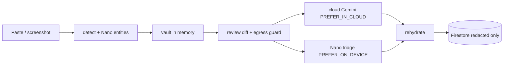

---
tags:
  - memory
  - architecture
  - airlock
last_updated: 2026-11-24
---

# Architecture

The flow is Input → Review → Result (the "chambers"). [[scrubbing]] runs deterministic detectors synchronously. [[hybrid-ai]] then asks Gemini Nano (ONLY_ON_DEVICE) for context entities on the rule-redacted text, chunked to the context window. The vault (placeholder → value) stays in React state only. Analyze (PREFER_IN_CLOUD) and triage (PREFER_ON_DEVICE) receive scrubbed text after the egress guard (findLeaks). Results are rehydrated for display. [[cloud-services]] saves only redacted incidents.

- Entry points: src/main.tsx (web), src/ext/sidepanel.tsx + src/ext/background.ts (extension)
- Data stores: Firestore users/{uid}/incidents (redacted only)
- External services: Firebase AI Logic (Gemini Developer API backend), App Check reCAPTCHA, Remote Config

Back to [[index]]
